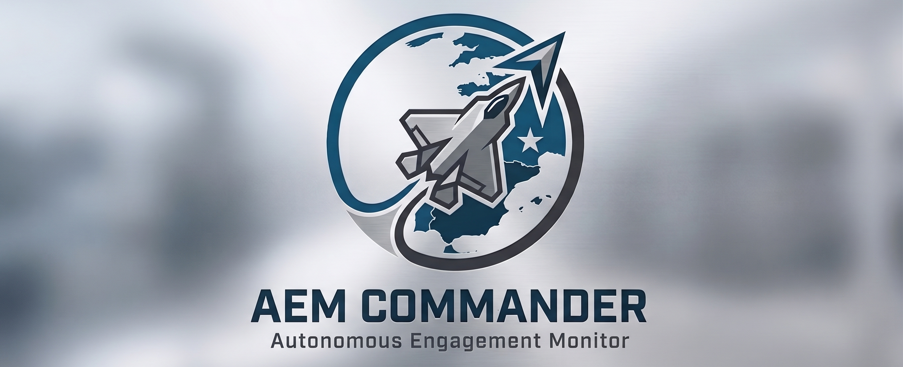

<p align="center">
  
</p>

# AEM Commander

**Autonomous Engagement Monitor** — a companion app for [DCS World](https://www.digitalcombatsimulator.com/) that brings a living battlefield to your missions: an HQ that issues orders to the armed forces (driven by an LLM, by a built-in rule engine, or by your own scripted plan), plus persistence, CSAR, civilian traffic, QRA intercepts, a BFM trainer and more.

> ⚠️ **Status: in development.** Features, settings and file formats may change between versions. Expect rough edges and please report issues.

---

## How it works

AEM Commander has two parts that talk over a local TCP socket (port `49080`):

1. **An Electron desktop app** (this repo) that holds the "brain": commanders, mission plan, persistence, and the UI.
2. **Lua scripts injected into your `.miz`** (built on [MOOSE](https://github.com/FlightControl-Master/MOOSE)) that export the battlefield state (order of battle, ISR contacts, goals, borders, events) and execute the orders they receive (spawn flights, route convoys, drop infantry, fire missiles...).

The app can run on the same PC as DCS or on another machine in the same LAN.

```
 DCS World  ──(Lua + MOOSE, TCP :49080)──►  AEM Commander app
 (mission)  ◄────────── orders ───────────   (commanders, plan, persistence)
```

## Features

### Theater commanders (Red and/or Blue)
- **Three modes:** `Hybrid` (AI with automatic rule-based fallback), `AI only`, or `Rules only` (no AI, no cost).
- **LLM providers:** Google Gemini (API key or Vertex AI service account) and any **OpenAI-compatible** endpoint (Groq, OpenRouter, Ollama, LM Studio, DeepSeek...).
- **Built to keep AI costs low:** the model is only consulted when the situation actually changes, with a single structured-output call per decision, configurable thinking level, optional "fast" and "strong" model tiers, hourly budgets (calls / tokens / cost) and automatic fallback to the rule engine after repeated failures.
- **Pre-analysed situation brief:** goals, nearby threats, closest capable reserves, SAM/CAP cover and recent events are computed in code and handed to the model.
- **Orders are validated in code**, not just requested in the prompt: unit capabilities, fixed-wing flights of two, combined-arms requirements, border crossings, ballistic missile range and inventory, and pacing limits.
- **Reactive escalation:** a threat posture (GREEN / YELLOW / RED) driven by detected enemies and losses, with a per-coalition aggressiveness setting.
- **Tasks:** `INTERCEPT`, `CAP`, `SEAD`, `CAS`, `STRIKE`, `ANTI-SHIP`, `ESCORT`, `CSAR`, `ASSAULT`, `TRANSPORT_TROOPS`, `TRANSPORT_LOGISTICS`, `FIRE_SUPPORT`, `BALLISTIC`, `RTB`.
- **Strike packages** rendezvous and push together; ground forces can route through border-crossing goals and deploy infantry to capture zones.
- **Ballistic missiles** with inventory, range, and depots that can be destroyed.
- Custom doctrine text per coalition and per-unit capability profiles.

### Mission Map & mission plan
- Preview your mission layout (groups, reserves, borders, goals) on a map before playing.
- Edit **goal priorities**, create **custom goals**, define **dependencies** between goals (goal B stays locked until goal A is completed), and set **scripted initial orders** (at start, after a delay, or when a goal is completed).
- Plans are stored per mission and layered on top of what the `.miz` defines.

### Persistence
- Tracks destroyed units, downed pilots, active groups, completed goals and ballistic missile stock across sessions.
- Optionally writes the latest group positions and the mission clock/date back into your `.miz` (a backup is created automatically).

### Extra modules (each one can be switched on/off)
| Module | What it does |
|---|---|
| **CSAR** | Ejected pilots spawn on land or water with SOS beacon, flare and F10 rescue menu. |
| **Civilian traffic** | Random airliners between chosen airbases and zones. Pick aircraft types and liveries from a catalog extracted from your own `.miz`. |
| **QRA interception** | Unidentified bogeys you must intercept and warn off (radio calls, gun warning shots, formation flying). |
| **BFM trainer** | 1v1 sorties with a wingman that swaps into an adversary, hard deck and "Knock it off" handling. |
| **Kneeboard** | Injects aerodrome data kneeboard pages from [DimOn by Minsky](https://forum.dcs.world/topic/269908-aerodrome-data-and-frequencies-updated-01-february-2026/) according to map and time of day. |
| **Wildfires** | *Work in progress, disabled by default.* |

### Tooling
- **One-click injection** of scripts, templates and media into a *copy* of your mission (`aem_next.miz`, the original is never modified).
- **Template builders:** late-activation templates are generated from your `AEM_RES` statics; CSAR and civilian templates, and payloads (loadouts), can be extracted from "master" `.miz` files.
- **Load settings from a mission** that already has AEM Commander injected.
- Live tactical map with beacons, light/dark theme and a built-in log viewer.

## Requirements

- **DCS World** with a mission you can edit.
- **[MOOSE](https://github.com/FlightControl-Master/MOOSE)** (and MIST if you use it) — the app can inject them if your mission doesn't already load them.
- **Windows** is the primary target (a macOS build is available through `electron-builder`).
- **Node.js** and npm, only if you run from source.
- For the AI commander: a Gemini API key / Vertex AI service account, or an OpenAI-compatible endpoint. Not needed in `Rules only` mode.
- TCP port **49080** free and not blocked by a firewall.

## Quick start

1. Download a release (or run from source, see below) and start **AEM Commander**.
2. Choose **Configure new settings & inject**, enable the modules you want and press **Inject Scripts to .miz**. This creates `aem_next.miz` next to your mission.
3. Open `aem_next.miz` in DCS and start the mission.
4. In the app, configure the commanders and press **Start Tracker**. The Lua script connects automatically (or via the **F10 → Connect to HQ** menu).

On later sessions choose **Load settings from your mission** to pick up where you left off.

### Preparing your mission (Mission Editor conventions)

| Element | Convention |
|---|---|
| Reserves | Static units named `AEM_RES...` containing task keywords (`CAP`, `SEAD`, `STRIKE`, `TRANSPORT_TROOPS`, ...). Their type, country and livery are used to build late-activation templates named `AEM_TPL_<SIDE> <TASK> <type>`. |
| Already deployed forces | Groups whose names contain task keywords (`CAP`, `SAM`, `AWACS`, `TANKER`, ...). |
| EW / SAM | Groups prefixed `RED EW` / `BLUE EW` and `RED SAM` / `BLUE SAM` (configurable). |
| Borders | A late-activation group named `RED BORDER` / `BLUE BORDER`; its route defines the polygon. |
| Goals | Trigger zones named `GOAL_RED...` / `GOAL_BLUE...` with properties such as `type`, `priority`, `peacetime` (and `bm_count` for ballistic missile depots). |
| Infantry | Templates `AEM_RED_INFANTRY` / `AEM_BLUE_INFANTRY`. |
| Persistence | Groups containing the keyword `PERSIST` have their positions saved. |

Goal types: `strike`, `bm_depot`, `conquer`, `resupply`, `border_crossing`, `deploy_infantry`.

## Running from source

```bash
git clone https://github.com/darcaem-dcs/aem-commander.git
cd aem-commander
npm install
npm start
```

Packaging:

```bash
npm run package-win   # Windows (electron-packager)
npm run package-mac   # macOS (electron-builder)
```

The `beacons`, `lua_scripts`, `media`, `loadouts`, `civ`, `csar` and `dimon` folders are shipped as extra resources.

## Project structure

```
main.js              Electron main process, TCP server, message routing
preload.js           IPC bridge
public/index.html    UI
lua_scripts/         Lua injected into the mission (code + generated values)
utils/               Commander engine, brief builder, rule commander, order validator,
                     LLM providers, mission plan/scanner, persistence, .miz patcher
                     and extractors (loadouts, civ, CSAR, statics)
```

## Known limitations

- Under active development: settings and save/plan formats can change.
- The Mission Map needs a coordinate projection for the theatre; a few maps are not supported yet.
- Naval groups cannot receive initial orders yet.
- Logistics deliveries currently end with an RTB (supply construction is not implemented).
- Wildfires module is experimental.

## Contributing

Bug reports, ideas and pull requests are welcome. Please open an issue first for larger changes. When reporting a problem, include the log from **Menu → View Log** and your DCS `dcs.log` if relevant.

## Credits

- [MOOSE](https://github.com/FlightControl-Master/MOOSE) — Moose Framework for DCS
- [rxi/json.lua](https://github.com/rxi/json.lua) — JSON for Lua
- [Leaflet](https://leafletjs.com/) and [OpenStreetMap](https://www.openstreetmap.org/) contributors
- [DimOn kneeboards by Minsky](https://forum.dcs.world/topic/269908-aerodrome-data-and-frequencies-updated-01-february-2026/)
- Font Awesome icons

## License

[MIT](LICENSE) © Alfonso Escriche Martínez
